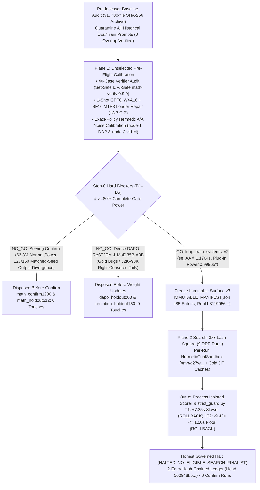

# Governed Qwen27B & MoE Reasoning Efficiency (`AILab_Qwen27B_Governed_v2`)

Self-contained codebase, frozen cryptographic governance contracts, decontaminated benchmark splits, and empirical learnings for optimizing **training and inference efficiency subject to strictly preserved reasoning and optimization quality** on **`Qwen/Qwen3.8-27B`** (dense hybrid Gated-DeltaNet + full-attention architecture with `15` native Multi-Token Prediction [MTP] tensors) and **`Qwen/Qwen3.5-35B-A3B`** (`35B` total / `3B` active hybrid MoE with `785` MTP tensors) across **3 nodes (`24x` NVIDIA A100-SXM4-80GB GPUs)** under **`/governed-loop-optimization`** (**Archetype D: Two-Plane Hybrid RSI**).

For the deep-dive engineering recipes, `v1 -> v2` forensic post-mortems, and practitioner playbook, see **[`docs/EXPERIMENT_LEARNINGS_AND_PLAYBOOK.md`](docs/EXPERIMENT_LEARNINGS_AND_PLAYBOOK.md)**.

---

## 1. Executive Summary (Self-Contained)

### Why Governed Efficiency Optimization Matters for Reasoning LLMs
Standard systems benchmarks optimize tokens/second or training step time in isolation, while naive post-training loops (`GRPO`, `ReST^EM`, LoRA SFT) frequently degrade completion rates or overfit small dev sets:
- In our predecessor baseline study (`v1`), `Qwen/Qwen3.8-27B` showed promising point speedups (`1.642x` native BF16 MTP3 dataset speedup; `1.498x` latency / `2.996x` GPU-hour reduction from `BF16 TP=2` to `GPTQ W4A16 TP=1`; `1.576x` SFT loop speedup with bundled `micro=4 + length balancing`), **but** suffered five structural blind spots:
  1. **1-GPU `INT4 + MTP3` crashed** in stock `vLLM`'s predictor loader (`weight_packed` mismatch on unquantized MTP layers).
  2. **Timing runs were non-interleaved (`BBBAAA`, `n=1..3`) with zero `A/A` baseline noise calibration (`se_AA`)**, leaving continuous-batching variance unquantified.
  3. **Symbolic math grading had `50%` false negatives on audited baseline misses** (`10/20` valid answers rejected due to set/tuple formatting, units, or `%` normalization).
  4. **Dense 50-update GRPO/TIS starved on `77.5%` uniform-reward dead groups** (`97.6%` saturated `MATH-500` ceiling, zero net reasoning gain).
  5. **MoE (`Qwen3.5-35B-A3B`) SFT passed `0.145%` NLL equivalence (`2.002x` faster loop) yet failed benchmark completion (`6.2%` length/parse failures)** because `32K` decoding was already right-censored before training (`5.2%` base failures) and trace filtering dropped all `>4K` teacher solutions (`37.5%` discarded).

### What `v2` Accomplished Under `/governed-loop-optimization`
We rebuilt the entire experimental stack as a **Two-Plane Governed Loop** (`IMMUTABLE_MANIFEST.json`, `85` SHA-256-locked entries, `manifest_root_sha256 = b8119956218d3bbb1561464c2827d07121017922d05d47b42decc465e8a0fbbc`), enforcing Plane-1 unselected calibration before Plane-2 trials, fresh detached Git scratch worktrees + empty compiler caches per run (`HermeticTrialSandbox`), out-of-process isolated scoring (`python -I -B`), and a hash-chained trial ledger (`results/governed_ledger_v2.jsonl`, `head_sha256 = 560948b57e4a00d8a8ae514abe7a184efe8bc92733686ef6d642b88ca0f02731`):

| Track | Governed Verdict | Self-Contained Empirical Finding |
| :--- | :--- | :--- |
| **1. Dense Speculative & Quantized Serving** (`Qwen3.8-27B`, `vLLM 0.29`, `32K` cap, `c=8`) | **1-Shot `INT4+MTP3` Repair Resolved (`Search`); `Confirm` Blocked (`Step-0 NO_GO`)** | Repaired `llmcompressor` `quantization_config.ignore` (`code/quantize_v2.py`) so stock `vLLM 0.29` loads **1-GPU `GPTQ W4A16 + Native BF16 MTP3` (`S3`, `18.7 GiB`)**. On 128 Search MATH tasks, `S3` hit **`96.88%` accuracy** vs 2-GPU `BF16 TP=2` (`S0`) **`95.31%`** (`2` wins, `0` losses, `126` ties), cutting wall time `719.37s -> 455.79s` and **participant GPU-hours `3.16x` (`0.3997 -> 0.1266` GPU-h)** (`S1` `BF16 TP=2 + MTP3` achieved lowest wall time at `407.01s`). However, post-`B4` hermetic `A/A` calibration (`plane1_serving_aa_hermetic_v2.json`) revealed **`127/160` matched `(ID, prompt_hash, seed)` pairs diverging in generated text** (e.g., Block-0 max tokens `12,249 -> 23,547` despite `22.60 +/- 0.046 ms` invariant TPOT), raising `se_AA` to **`113.59` GPU-s** and dropping Normal Confirm power to **`63.76% < 80%`** under unrelaxed gates (`310` GPU-s floor, `2.0 pp` KL-Hoeffding NI). Blocked at Step-0 (`0` touches on `math_confirm1280` / `math_holdout512`). |
| **2. Dense 8-GPU DDP SFT Systems** (`1,024` `<=4K` rows, `16` updates) | **Admitted (`Step-0 GO`, `se_AA = 1.1704s`) -> Halted Cleanly After Search (`0` Promotions)** | Executed 3-block `3x3` Latin-Square Search (`9` DDP runs inside per-run `HermeticTrialSandbox`, identical `340,797` input / `254,724` supervised tokens & `16` optimizer groups per run):<br>• **`T0` (`micro=1, no bucket`):** **`309.33s`** loop, `0%` pad, `417.66 kJ`, `55.14 GiB` (**Incumbent Retained**).<br>• **`T1` (`micro=4, no bucket`):** **`316.58s` (`+7.25s` slower, `ROLLBACK`)** due to **`+71.94%` right-padding** (`585,964` padded tokens) and `+10.28%` higher loop energy.<br>• **`T2` (`micro=4 + length bucketing`):** **`299.91s` (`-9.43s <= 10.0s` Search gate, `ROLLBACK`)** — descriptive updates `2–16` run-median step time fell **`11.24s -> 6.00s`**, but cold step-1/bucket startup (`146.57s` vs `123.36s`), `+57.04%` padding (`535,180` tokens), **`+3.31%` higher board energy (`431.47 kJ`)**, and `60.90 GiB` peak memory kept cold 16-update net wall gain just under `10.0s`. Zero Confirm runs launched. |
| **3. Dense Verified RL / `ReST^EM`** (`DAPO-Math-17k`) | **`Step-0 NO_GO`** | Pre-flight audit caught published `DAPO-Math-17k` gold contradictions (`dapo:b57078e1...`, `dapo:e09849b4...`), right-censored `32K` rollout tails (`36/768 = 4.69%` truncations, `p99 = 32,768`), **`96.5%` token discard (`5.58M / 5.78M` generated tokens dropped)**, and `<25%` Confirm power for `1–2 pp` gains. |
| **4. Hybrid MoE Reasoning** (`Qwen3.5-35B-A3B`) | **`Step-0 NO_GO`** | Scaling only outer `max_tokens` `32K -> 48K -> 98K` lifted base Search accuracy **`91.41% -> 94.53% -> 95.31%`** (`uncensored p95 = 35,738 > 32,768`), proving `v1`'s MoE failure was a pre-training truncation artifact; `3/128 = 2.34%` still looped to `98,304` under `presence_penalty = 0.0` (official card specifies `1.5`). |

---

## 2. Two-Plane Governed Architecture



*\*Preflight `0.99965` figure is a conditional plug-in planning estimate assuming healthy DDP launches, `delta_plan = 55.0s`, `+0.0010` BF16 associativity NLL shift, and `58.5 GiB` peak memory (`80%` significance-only MDE vs zero-effect null `= 3.28s`, distinct from the `>= 25.0s` Confirm practical gate) — not an unconditional finite-sample guarantee.*

---

## 3. Detailed Empirical Results & Engineering Breakdown

### 3.1 Symbolic Verifier Hardening (`eval/verifiers_v2.py`) & 1-GPU `INT4 + BF16 MTP3` Serving (`code/quantize_v2.py`)

1. **`B1` Set-Safe & Percent-Safe Symbolic Math Grading (`eval/verifiers_v2.py`, `tests/test_verifier_semantic_sets.py`):**
   - Decoupled strict admission formatting from lenient semantic equivalence on `Python 3.12.3` / `math-verify 0.9.0` / `SymPy 1.14.0` (unmodified production timeouts, `20/20` unit tests passing).
   - Preserved unordered finite-set semantics for comma-separated solution lists (`81, 256` $\leftrightarrow$ `{81, 256}`) while blocking continuous open-interval `(81, 256)` coordinate-pair false positives, and normalized single `number\%` forms prior to `math-verify`'s string fallback.
   - Replaying `v1`'s `40`-case audit (`sources/research_baseline_verifier_semantic_audit.json`) preserved **`20/20` baseline passes** and repaired **`10/20` false negatives** (`30/40` valid acceptances; `7` genuinely wrong answers, `1` unusable channel, and `2` malformed references rejected; `0` execution errors).

2. **Resolving Stock `vLLM 0.29` 1-GPU `GPTQ W4A16 + Native BF16 MTP3` (`code/quantize_v2.py`):**
   - **Root cause:** During `llmcompressor` `oneshot` GPTQ calibration of `Qwen3_5ForConditionalGeneration`, HuggingFace's forward pass does not invoke `mtp.*` layers, causing `llmcompressor` to omit `mtp.*` module patterns from `config.json["quantization_config"]["ignore"]`. At serve time, `vLLM`'s `Qwen3_5MTP` speculative worker then expects INT4 `weight_packed` tensors for `mtp.*` and crashes.
   - **1-shot fix:** Selectively quantize backbone linears to `W4A16` (`128` calibration sequences from `sft_systems1024_v2`), copy all `15` native `mtp.*` tensors bitwise in `BF16` alongside `lm_head`, and explicitly inject `VLLM_MTP_IGNORE_ENTRIES` (`mtp.fc`, `mtp.layers.0.*`, `re:^mtp\..*`) into `quantization_config.ignore` (`18.7 GiB` footprint on 1x A100-80GB).

3. **Rescored Unselected `math_search128` (`N = 128`, `cap = 32,768`, `concurrency = 8`) Tradeoff Matrix (`results/plane1_search128_serving_discordance_rescored_v2.json`):**

| Serving Arm | Precision & Layout | Native MTP | Lenient Acc | Dataset Wall (s) | Participant GPU-h | MTP Draft Acc | SLO-Correct Goodput (`req/s`)* |
| :--- | :---: | :---: | :---: | :---: | :---: | :---: | :---: |
| **`S0` (Baseline)** | `BF16`, `TP=2` (2 GPUs) | Off | `95.3125%` (`122/128`) | `719.3735s` | `0.399652` | — | `0.152911` (`110` SLO-ok) |
| **`S1` (Fastest Wall)** | `BF16`, `TP=2` (2 GPUs) | `MTP=3` | `96.0938%` (`123/128`) | **`407.0079s` (`1.77x`)** | `0.226116` (`1.77x`) | `73.4%` | **`0.302205`** (`123` SLO-ok) |
| **`S2` (Bundled Quant+TP1)** | `GPTQ W4A16`, `TP=1` (1 GPU) | Off | `94.5312%` (`121/128`) | `586.2095s` (`1.23x`) | `0.162836` (`2.45x`) | — | `0.206411` (`121` SLO-ok) |
| **`S3` (Lowest GPU Cost)** | `GPTQ W4A16`, `TP=1` (1 GPU) | **`BF16 MTP=3`** | **`96.8750%`** (`124/128`) | `455.7875s` (`1.58x`) | **`0.126608` (`3.16x`)** | `62.7%` | `0.272057` (`124` SLO-ok) |

*\*Frozen `code/infer_v2.py` SLO-correct goodput predicate: `count(finish_reason == "stop" AND not natural_stop_lenient_parse_failure AND ttft_seconds <= 2.0 AND (tpot_seconds is None or tpot_seconds <= 0.1) AND including_client_queue_seconds <= 600.0 AND lenient_correct) / dataset_seconds` at closed-loop `concurrency = 8`. Single-run Search diagnostic only (precision and `TP=2 -> TP=1` are bundled in `S2`/`S3`), not a confirmed promotion.*

4. **Why Serving Confirmation Was Blocked at Step-0 (`results/plane1_serving_aa_hermetic_v2.json`):**
   - Across `5` interleaved `AB/BA` baseline (`S0` vs `S0`) blocks (`160` matched `(ID, prompt_hash, request_seed)` pairs on dedicated `node-2`), hardware per-token latency was rock-solid (`tpot_p95_ms = 22.60 +/- 0.046 ms`, `0` errors, `100%` stop rate), **yet `127/160` matched pairs emitted different reasoning trajectories** (`vLLM 0.29.0` continuous-batching numerical/scheduling non-determinism at `temperature = 1.0, concurrency = 8` is plausible context), shifting Block-0 max length `12,249 -> 23,547` tokens and 32-item wall time `294.12s -> 536.06s` (`se_AA = 113.59` GPU-s -> Normal primary power **`0.637633 < 0.80`**). Rather than dropping the noisy block or relaxing gates post-hoc, `configs/step0_serving_confirm_nogo.json` enforced `Step-0 NO_GO`.

---

### 3.2 Admitted Plane-2 8-GPU DDP SFT Systems Loop (`loop_train_systems_v2`)

Evaluated `3` Latin-Square blocks (`[T0,T1,T2], [T1,T2,T0], [T2,T0,T1]`, `9` DDP runs on `8x` A100-SXM4-80GB `node-1`) on short-reference (`<= 4K`) `data/splits/sft_systems1024_v2.jsonl` (`1,024` presentations, `340,797` input tokens, `254,724` supervised tokens, `16` identical global optimizer groups per run) inside fresh per-run `HermeticTrialSandbox` worktrees and empty compiler caches:

| Arm | DDP Configuration (`global_batch = 64`) | Padded Tokens (`pad / input`) | Primary Mean `loop_seconds` (All 16 Updates) | Descriptive Update-1 Mean | Descriptive Updates `2–16` Mean of Run Medians | Pooled Partial Matmul MFU Range* | Mean `after_nll` (Max) | Max Peak Alloc GiB | Mean Loop Board Energy | Ledger Verdict (`min_improvement = 10.0s`) |
| :--- | :--- | ---: | ---: | ---: | ---: | :---: | ---: | ---: | ---: | :--- |
| **`T0`** | `micro=1, bucket=False` | `340,797` (`+0.00%`) | **`309.3331s`** | `123.36s` | `11.2360s` | `4.5674%–4.5801%` | `0.63065` (`0.63108`) | `55.1408` | `417,655.85 J` | **Incumbent Retained** |
| **`T1`** | `micro=4, bucket=False` | `585,964` (`+71.94%`) | **`316.5847s`** (`+7.2517s`) | `147.11s` | `7.2012s` | `4.4628%–4.4752%` | `0.62919` (`0.62947`) | `60.4217` | `460,589.40 J` (`+10.28%`) | **`ROLLBACK`** (`73141b17...`) |
| **`T2`** | `micro=4, bucket=True` | `535,180` (`+57.04%`) | **`299.9074s`** (`-9.4256s`) | `146.57s` | `5.9958s` | `4.7110%–4.7241%` | `0.62931` (`0.62948`) | `60.8966` | `431,470.29 J` (`+3.31%`) | **`ROLLBACK`** (`560948b5...`, `9.43s <= 10.0s`) |

*\*Pooled partial algorithmic matmul-only MFU against `312` dense BF16 TFLOP/s per A100 (`code/flops.py`): lower/upper reflects causal vs full-square attention accounting conventions (not a CI, full hybrid-model MFU, HFU, or GPU utilization); useful unpadded matmul work is numerator, cold-loop wall time is denominator, and Gated-DeltaNet recurrence/conv/norm/optimizer FLOPs are omitted. Workload scope is short-reference (`<=4K`), cold-cache `16`-update SFT systems — not `32K` reasoning training or downstream reasoning-benchmark confirmation.*

---

## 4. Core Scientific & Systems Learnings

1. **`/governed-loop-optimization` prevents false discoveries before compute and holdouts are burned:** Enforcing Step-0 `se_AA` power gates, verifier false-negative audits, and truncation tail checks (`cap >= 1.5x uncensored p99`) cleanly stopped three invalid/underpowered loops before touching `math_confirm1280` or any Protected Holdout (`0` touches).
2. **One-shot root-cause fixes beat blind multi-round search on systems bottlenecks:** Fixing `llmcompressor`'s dropped `mtp.*` ignore list (`S3`), repairing set/interval & `%` symbolic grading (`verifiers_v2.py`), fixing HuggingFace's `.eval()` DDP load state + Liger `skip_logits=True` (`78.4 GiB OOM -> 55.1 GiB`), and uncensoring MoE `max_tokens` (`91.41% -> 95.31%`) each unlocked immediate, transparent gains.
3. **Stochastic reasoning serving benchmarks are dominated by emitted-work variance, not kernel jitter:** Even at `0.2%` TPOT stability, continuous batching at `T=1.0` causes `79.4%` (`127/160`) matched-seed text divergence. Powered `AB/BA` serving confirmation requires batch-invariant kernels, fixed-trajectory prefill/decode replay, or `>= 4x` more paired blocks.
4. **Microbatching heterogeneous reasoning traces requires bucketing/packing AND warm-cache amortization:** Naive `micro=4` (`T1`) regresses wall time (`+2.3%`) and board energy (`+10.3%`) via `+71.9%` right-padding. Within-update length bucketing (`T2`) cuts descriptive updates `2–16` median step latency (`11.24s -> 6.00s`), but over a short `16`-update cold-cache horizon its longer Step-1/shape initialization and `+57.0%` residual padding leave `-9.43s` net gain (plus `+3.31%` board energy), pinpointing **sequence packing (varlen FlashAttention / GDN) + persistent compiler-cache warmup** as the next lever.

---

## 5. Repository Layout & Zero-Install Cryptographic Verification

| Path | Contents |
| :--- | :--- |
| `program.md`, `IMMUTABLE_MANIFEST.json` | Complete 8-section governed loop contract and `85`-entry `lstat`/SHA-256 manifest (`manifest_root_sha256 = b8119956218d3bbb1561464c2827d07121017922d05d47b42decc465e8a0fbbc`). |
| `docs/EXPERIMENT_LEARNINGS_AND_PLAYBOOK.md` | Self-contained research post-mortem, `v1 -> v2` comparison, code recipes, and practitioner playbook. |
| `eval/` | Pure-stdlib `governed_loop_guard.py`, `strict_guard.py` (KL-Hoeffding paired cluster NI, Monte Carlo full-gate power, pre-GPU/holdout cryptographic boundary gates), `isolated_scorer.py`, and set/%-safe `verifiers_v2.py`. |
| `code/` | `plane2_governed_runner.py` (`HermeticTrialSandbox`, true `2x2` DiD synergy, fail-closed `owned_server` retirement), `train_systems_v2.py` (8-GPU DDP trainer, Liger fused CE, `FP32` LoRA merge `<= 1 BF16 ULP` + 15-tensor MTP byte oracle), `quantize_v2.py` (`GPTQ W4A16 + BF16 MTP3`), `infer_v2.py`, `flops.py`, `rescore_plane1_search_v2.py`, `generate_frozen_contracts.py`. |
| `configs/` | `step0_preconditions.json` (`GO`), `step0_serving_confirm_nogo.json` (`NO_GO`), `gate_rules_*.json`, `model.json`, `moe_model.json`, pinned `requirements-*.txt`. |
| `data/splits/`, `data/traces/` | Decontaminated `Search / Confirm / Protected Holdout (prompt-only)` splits (`0` cross-split or `v1` historical overlaps) and MoE/SFT calibration traces. |
| `results/` | Hash-chained `governed_ledger_v2.jsonl` (`head = 560948b5...`), `final_governed_publication_v2.json`, `resource_accounting_v2.json`, Plane-1/Plane-2 adjudication JSONs, and all `59` per-run `summary.json` records (`29` DDP training + `30` vLLM inference). |
| `tests/`, `sources/` | `20` unit & adversarial boundary tests (`test_strict_guard.py`, `test_verifier_semantic_sets.py`, `test_merge_oracle.py`, `test_merge_export.py`) and 40-case baseline verifier audit fixtures. |

### Reproduce Cryptographic Manifest, Ledger & Precondition Checks (Pure Python 3.10+ Stdlib)

```bash
# 1. Verify all 85 frozen files match the pinned root digest bit-for-bit
python -I -B eval/governed_loop_guard.py verify-manifest \
  --manifest IMMUTABLE_MANIFEST.json \
  --root . \
  --expected-root-sha256 b8119956218d3bbb1561464c2827d07121017922d05d47b42decc465e8a0fbbc

# 2. Verify the 2-entry SHA-256 hash-chained Plane-2 Search ledger
python -I -B eval/governed_loop_guard.py verify-ledger \
  --ledger results/governed_ledger_v2.jsonl \
  --expected-head-sha256 560948b57e4a00d8a8ae514abe7a184efe8bc92733686ef6d642b88ca0f02731

# 3. Reproduce Step-0 GO on Training Systems vs Step-0 NO_GO on Serving Confirm
python -I -B eval/strict_guard.py check-preconditions --config configs/step0_preconditions.json
python -I -B eval/strict_guard.py check-preconditions --config configs/step0_serving_confirm_nogo.json

# 4. Run full 20-test verifier, merge-ULP, hermetic-worktree & guard suite (after installing configs/requirements-training.txt)
python -I -B -m unittest discover -s tests -v
```

### Non-Additive Multi-Scope Compute Accounting (`results/resource_accounting_v2.json`)
Different-coverage, overlapping scopes are **never summed**:
- **Scope 1 (Recorded Active Phases across all `59` `summary.json` runs):** `16.8589` training-loop GPU-h + `13.8005` inference-request GPU-h = **`30.6594` active-phase GPU-h** (`27.12 MJ` / `7.53 kWh` board energy; `12,644,129` emitted inference tokens).
- **Scope 2 (Explicitly Retired `vLLM` Server Lifetimes, `11` daemons):** **`17.1948` GPU-h** (nested inside controller stages).
- **Scope 3 (Disjoint Top-Level Controller Stages, `27` stages across `3` nodes):** **`44.3739` completed + `4.3801` failed/interrupted = `48.7539` assigned stage GPU-h**.
